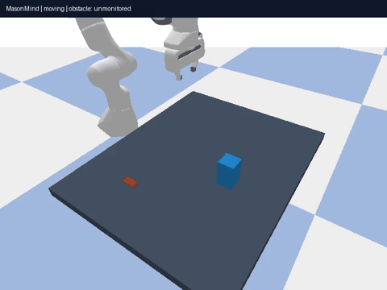
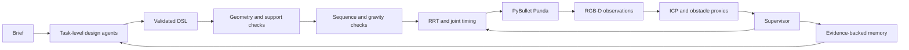

# MasonMind

Research implementation of robotic masonry with a Franka Panda and task-level LLM agents.



Recorded full 12-brick build with a moving obstacle, accelerated approximately 21x.

## Start here

The prepared Windows environment can run directly:

```powershell
.\run.ps1 -Mode design
.\run.ps1 -Scenario moving_obstacle -NoVideo
.\run.ps1 -Mode app
.\run.ps1 -Mode test
```

The optional Gradio interface opens at http://127.0.0.1:7860. Generate a design,
review its placement animation and agent outputs, then start construction.
The construction video and measured deviations appear after completion; the UI
does not stream live video. Install `pip install -e ".[ui]"` in a fresh environment.
The default CLI now runs the entire pipeline; use `--no-video` for faster runs.



**Verified delivery:** 53 automated tests pass. A complete quick experiment matrix
contains 36 trials: B0 completed 3/9, B1 5/9, B2 6/9 and B3 6/9 (20/36 total).
The difficult noisy-placement, early-drop and combined scenarios fail in this
seed-0 coarse-sampling matrix; failures remain in the CSV. B2 and B3 being equal
does not establish a memory benefit. Live paid providers have not been tested.


Source specification: [PROJECT_SPEC.md](PROJECT_SPEC.md). Detailed implementation
history: [docs/DEVELOPMENT.md](docs/DEVELOPMENT.md).

**Division of labor:** deterministic algorithms solve geometry and motion. LLM agents
make design and task-level decisions. LLMs never produce coordinates, joint angles,
or trajectories. The default provider is a deterministic offline mock.

## Installation

Python 3.10+ (local environment uses Python 3.11). From this directory:

```powershell
python -m venv .venv
.\.venv\Scripts\Activate.ps1
pip install -e ".[dev,ifc,experiments]"
python -m masonmind --help
pytest
```

Configuration lives in `configs/default.yaml` and `configs/llm.yaml`.
Generated artifacts belong in ignored `runs/`; credentials belong in environment variables.

Windows installs the `pybullet-arm64==3.2.8` distribution, which also ships x86-64
wheels and imports as `pybullet`. This is a packaging fork, not a different physics
engine. Upstream `pybullet==3.2.7` has no Windows wheels and requires MSVC to build.
See [upstream files](https://pypi.org/project/pybullet/3.2.7/) and
[Windows wheel distribution](https://pypi.org/project/pybullet-arm64/).

## Milestone status

- M0: package, strict schemas, all nine offline agent outputs, configuration,
  artifact logging and CLI. Acceptance: 11 tests passed; CLI help works.
- M1: isolated PyBullet world, Panda, supply, finger-contact-checked fixed grasp,
  motor-driven joint interpolation and RGB-D camera with MP4 recorder.
  Acceptance: five bricks placed; physics pick/place test passes (12 tests total).
- M2: seeded DSL compiler and footprint verifier. Acceptance: 24 tests pass,
  including three distinct 20-degree patterns, hand-made failures for every check,
  running bond, rule composition and a full-size verifier runtime below one second.
- M3: precedence graph, six strategies, vertical finger-box clearance, physics
  checkpoints and open-loop B0 construction. Acceptance: 27 tests pass; both
  left-to-right and right-to-left build 12-brick walls. Measured maximum final
  errors: 3.67 mm and 1.46 mm respectively. A clearance test passes only one order.
- M4: seven-joint RRT-Connect, shortcut smoothing, trapezoidal joint profiles,
  robot/scene/self/held-brick collision checking. Acceptance: 32 tests pass;
  both 12-brick builds report zero contact ticks with the fixed obstacle.
  First acceptance run: mean planning time 3.8 ms, worst query 264 ms; maximum
  placement errors 6.66 / 4.33 mm (not yet corrected by perception).
- M5: bounded multi-agent Phase A, audited providers, output validation/retries,
  content-addressed cache, IFC4 export. Acceptance: 35 offline tests pass; mock
  repairs one deliberately unsupported program, approves 12 bricks, and exports
  an IFC with one geometric element and order property per brick.
- M6: two-view depth unprojection, masked unknown-object clustering, per-brick
  point-to-plane Open3D ICP, heatmap and separate ground-truth evaluation.
  Acceptance: 37 tests pass; noisy six-brick course mean scan error **0.027 mm /
  0.014 degrees** with ideal depth. The padded perceived obstacle box encloses
  the known test obstacle. These are synthetic-sensor results, not real-camera claims.
- M7: monitored execution, speed zones, stop/replan/escalation, scripted obstacles,
  release noise/drop/damaged stock, stock and brief events, all seven supervisor
  actions. 44 offline tests pass, including physical reposition/replacement.
  Full moving-obstacle run: 12 bricks, 1 stop, 1 successful replan, zero obstacle
  contact ticks. Blocking run: supervisor WAIT after timed-out replanning,
  completion with zero obstacle contact ticks. Noise comparison is recorded below.
- M8: VLM Critic with image inputs and explicit mock-score labelling; append-only
  memory with evidence, confirmation counts, keyword/confidence/recency retrieval.
  Acceptance: 46 tests pass; noisy-placement incidents write rules, and a subsequent
  Architect call includes a previously stored rule in its audited prompt.
- M9: genuine variant/scenario/seed matrix, atomic CSV output, retained failures,
  measured metrics and PNG/PDF plots. Acceptance: 49 tests pass; `--quick` finished
  all 36 trials and created comparison figures. Completion: B0 3/9, B1 5/9,
  B2 6/9, B3 6/9 (20/36 total). Mock memory did not improve these outcomes.
- M10: optional local Gradio design review and construction UI, Windows launcher,
  recorded demo, documentation and measured experiment plots. Acceptance: 53 tests
  pass, including HTTP page serving; static undefined-name/type-annotation checks
  and dependency consistency pass. The UI returns recorded rather than live video.
  Final recorded run `20261003T082556_6b444c2b`: 12/12 bricks, zero obstacle
  contact ticks, one stop and one successful replan, mean placement error 0.0264 mm.
  Recording 24 fps at 640x480 took about 26 minutes on the development machine;
  use `--no-video` for faster experiments. This is simulation-time monitoring,
  not a demonstrated wall-clock real-time hardware controller.

```powershell
python scripts/demo.py --milestone 1
```

The command saves `video.mp4`, `final.png`, a configuration snapshot and a measured
placement report in a unique `runs/` directory. Use `--no-video` for faster tests.
The M1 controller interpolates joint targets and is an open-loop baseline; it has
no obstacle avoidance yet. It never teleports bricks to make placement succeed.

`python scripts/demo.py --milestone 2` saves three verified designs and PNG previews.
Brick centres use metres in the simulation world frame. The wall runs along X and
is centred at `geometry.origin`; its Z coordinate denotes the table surface.
Rotation is around each brick's own Z axis. Phase shifts are radians per course.
Regions include their course bounds; `u` uses the cell centre along the wall.
Diamond uses a normalized Manhattan-distance shape; stripe uses a centred interval.
Gradient/random openings use seeded Bernoulli sampling; checker further restricts
the alternating parity cells. Geometry may reject artistic requests when they
create unsupported bricks; the compiler does not silently fill openings.

`python scripts/demo.py --milestone 3 --no-video` runs both B0 orders. Final descent
and retreat use sampled Cartesian vertical lines; joint interpolation alone can
sweep a carried brick sideways into an adjacent brick. Drop tests measure motion
over a finite settling period, not a proof of structural safety under future loads.

`python scripts/demo.py --milestone 4 --no-video` adds a fixed obstacle and reports
planning times and obstacle contact ticks. Default pitch is now 62 mm, leaving
clearance around 54 mm bricks. Collision paths are discretely sampled, not
continuous-time certified. Intended finger-grasp and upward supporting contacts
are permitted only during relevant approach/lift/place phases with a penetration
limit; other known objects remain collision geometry. Motor tracking and physics
still produce placement error, which must be measured rather than assumed zero.

## DSL reference

```json
{
  "n_courses": 3,
  "bricks_per_course": 6,
  "bond": "stack",
  "rotation_rules": [{
    "region": {"course_start": 0, "course_end": 2, "u_start": 0, "u_end": 1},
    "kind": "wave", "amplitude_deg": 20, "frequency": 1,
    "phase_shift_per_course": 0, "combine": "override"
  }],
  "opening_rules": [],
  "seed": 7,
  "rationale": "Repeat a shallow wave across supported courses"
}
```

| Field | Values and meaning |
| --- | --- |
| `n_courses`, `bricks_per_course` | 3–15 courses; 4–14 cells per course |
| `bond` | `stack` or `running` |
| Rotation `kind` | `wave`, `zigzag`, `twist_gradient`, `alternate`, `constant` |
| `amplitude_deg`, `frequency` | 0–45 degrees; positive frequency |
| `combine` | Apply rules in order using `add` or `override` |
| Opening `kind` | `gradient`, `diamond`, `stripe`, `checker`, `random` |
| `ratio_start`, `ratio_end` | Removal probabilities from 0 to 0.5 |
| Opening `size` | Optional normalized geometric opening extent, greater than 0 and at most 1 |
| `region` | Inclusive course indices and normalized wall interval `u` |

The strict schema rejects extra fields. The compiler computes coordinates and the
verifier can reject a schema-valid program. See `tests/test_design.py` for examples.

## Configuration and outputs

| YAML section | Controls |
| --- | --- |
| `geometry` | Brick dimensions, pitch, origin, footprint and support limits |
| `sim` | Physics, supply, Panda home, grasp, camera and video |
| `planning` | RRT limits, edge sampling, joint speed and slowdown/stop distances |
| `sequence` | Finger geometry, approach and intermediate stability checks |
| `scan` | Camera views, ICP, clustering, noise and deviation tolerances |
| `construction` | Intervention bounds, scripted disturbances and batch answers |
| `agents`, `memory` | Repair limits, persistent rule path and retrieval count |

Scenario overrides live in `configs/scenarios/`. Provider selection is separate
in `configs/llm.yaml`. Every run saves configuration and design versions, verifier
reports, sequence, agent audit JSONL, motion/planning logs, course scan results,
final report and optional IFC/video inside its unique `runs/` folder.
Supervisor actions are `ACCEPT`, `REPOSITION`, `REPLACE`, `RESEQUENCE`,
`REPLAN_REMAINING`, `WAIT` and `ASK_USER`; each has an implemented handler.

## Agents and providers

`python scripts/demo.py --milestone 5 --text "A three-course wall"` runs Phase A.
MockClient is an integration fixture, not a language interpreter: it returns a
small stable wall and deliberately triggers one geometric repair. Real text-to-DSL
generation requires changing `provider` and `model` in `configs/llm.yaml`. Use
`openai` with `OPENAI_API_KEY`, `anthropic` with `ANTHROPIC_API_KEY`, or `ollama`
with a local server URL. No paid API calls were made during development.
Live-provider transports are implemented but require a configured compatible
model and have not been acceptance-tested against paid endpoints.

Provider references: [OpenAI structured outputs](https://developers.openai.com/api/docs/guides/structured-outputs),
[Anthropic Messages](https://platform.claude.com/docs/en/api/messages/create),
[Ollama chat](https://docs.ollama.com/api/chat). Every response is validated locally;
an invalid response gets three repair retries. Cache keys include model, provider,
endpoint, prompt, schema and image hashes. `llm_log.jsonl` includes all attempts,
responses, validation errors, latency and available token usage, never credentials.

Phase A robot review currently checks target IK and empty-scene approach planning;
carried-object paths through the evolving scene are checked at construction time.
An agent cannot override a failed deterministic check.

## Perception

Install `pip install -e ".[scan,ifc]"` and run `python scripts/demo.py --milestone 6`.
The control-side detector receives only image-derived points and known-body IDs;
it has no simulator pose access. Brick IDs use simulated instance segmentation,
which is an optimistic association assumption. ICP registers visible observations
to a sampled nominal box; evaluation reads ground truth in a separate module.
Missing means **unobserved**, which can also mean occluded. Obstacle bounds cover
observed surfaces with configurable padding, not all possible hidden geometry.
TinyRenderer's integer-X / inverted-Y pixel convention is tested by calibrated
boxes; using a generic pixel-centre offset introduces millimetre-scale bias.

## Closed-loop construction

```powershell
python scripts/demo.py --milestone 7 --scenario moving_obstacle --no-video
python scripts/demo.py --milestone 7 --scenario blocking_obstacle --no-video
python scripts/demo.py --milestone 7 --scenario noisy_placement --variant B0 --no-video
```

Control uses invisible collision proxies made from design/scan poses and perceived
obstacle bounds. Ground-truth poses are read only by simulation mechanics and
separate evaluation. Every course scan includes the entire built structure.
Loaded bricks cannot be extracted until their dependents are addressed; such an
unsafe requested correction fails explicitly. New programs preserve built courses
and must pass geometry, sequence and drop checks before continuing.
Batch user responses are explicit configuration entries and are recorded. Supply
shortage uses `replenish`; a changed brief uses `keep_current_design` by default.
Pass an `ask_user` callback to Orchestrator for real interaction or revised DSL.

The low-scale contact model uses configurable damping, friction anchors and small
collision margins to prevent numerical drift of 54 mm bricks. During vertical
extraction, fitted brick proxies allow 0.2 mm contact uncertainty; this exception
never applies to unknown obstacles. An approaching obstacle may continue closer
after the arm stops: observed minimum clearance was about 11 mm in the scripted
test, despite the 50 mm stop trigger. This is not a physical safety guarantee.

Broken-stock comparison (seed 1): the B0 mean pose error is 0.025 mm, but its
mean geometry deviation including size mismatch is 2.046 mm. Replacement removes
the damaged stock; the closed-loop pose error was 0.027 mm. There is **no measured
improvement in pose-centre error** for this particular broken-stock seed; shape
conformance is the relevant improvement. Keep these metrics distinct.

Noisy-placement comparison (seed 7): B0 mean/max final displacement **7.332 /
17.696 mm**, with a course-height loss detected; closed loop **0.444 / 2.710 mm**,
completed after three REPOSITION decisions, zero obstacle contacts.

## Memory and critique

Memory is enabled only in B3 construction (and configurable in standalone Phase A).
Example rule written after an actual correction:

> Inspect each completed course and correct measured placement errors before adding load.

Its record includes `run_id`, `course`, `brick_ids`, `confidence: 0.6`, and an
increasing `times_confirmed`. Later Architect, Strategist, StructuralEngineer and
Supervisor inputs contain a `memory_rules` list; inspect `llm_log.jsonl` to audit it.
Set `memory.enabled: false` to disable both reading and writing.
The mock critic always returns 7/10 with an explicit fixture warning. This checks
the integration and cannot support a scientific claim about design intent.

## Experiments

```powershell
pip install -e ".[experiments]"
python experiments/run_all.py --quick
python experiments/run_all.py --seeds 3 --jobs 2
python experiments/plots.py experiments/results.csv
```

Quick runs all four variants and all nine scenarios with seed 0. It uses a 20 mm
Cartesian approach sampling step and 96x72 monitoring frames for runtime; it is
an integration check, not a publication-quality benchmark. Normal runs retain
the configured motion/sensor parameters and use `configs/llm.yaml`; quick uses
`configs/llm_mock.yaml`. Memory is isolated by variant/seed, then retained across
scenarios in a batch. Matplotlib is the additional lightweight plotting dependency.
`results.csv` includes failures, run paths, costs (unknown prices remain null),
scan accuracy, motion events, corrections and design signatures. Diversity across
seeds is undefined for a one-seed quick run. Plot averages include measured failed
trials; duration is wall-clock time, also affected by concurrent runs.

This is simulation research software. It is not a certified controller for hardware.

### Measured results at normal fidelity

| Scenario / variant | Completion | Measured outcome |
| --- | --- | --- |
| Moving obstacle / B3 | Yes | 1 stop, 1 replan; zero scripted-obstacle contact ticks |
| Blocking obstacle / B3 | Yes | WAIT intervention; zero scripted-obstacle contact ticks |
| Noisy placement / B0, seed 7 | No | Mean displacement 7.332 mm; collapse detected |
| Noisy placement / B3, seed 7 | Yes | Mean displacement 0.444 mm; 3 reposition actions |
| Broken stock / B0, seed 1 | — | Pose error 0.025 mm; size-aware geometry deviation 2.046 mm |
| Broken stock / B3, seed 1 | Yes | Replacement; pose error 0.027 mm |

These are individual simulation trials, not statistical evidence of general
performance. The collision metric counts contact ticks with scripted obstacles,
not every robot/brick contact. Corrective placement uses calibrated motion without
reinjecting disturbance noise. Real cameras, real robot hardware, and live LLM
quality remain unvalidated. The broken-stock pose-centre improvement requested
in M7 is not demonstrated; the measured benefit is shape conformance.
