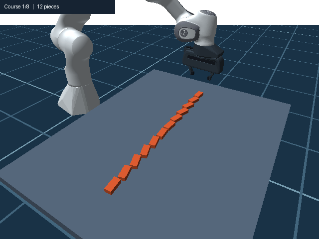
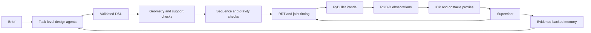
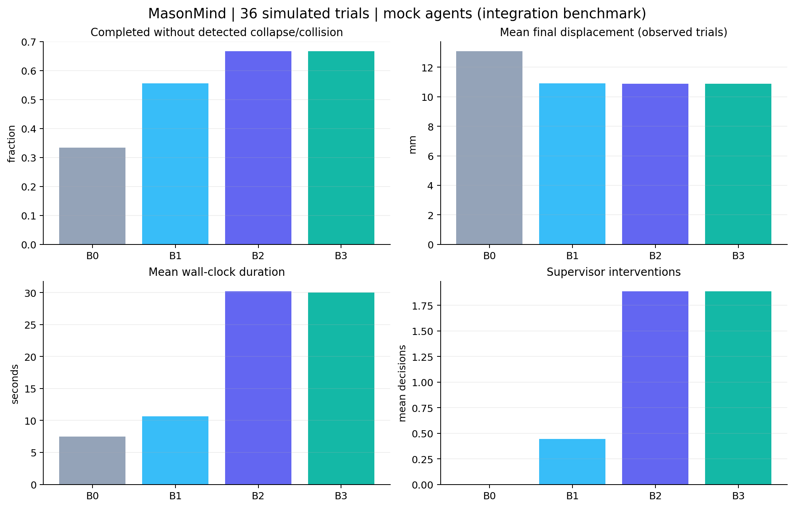

# MasonMind

Research implementation of robotic masonry with a Franka Panda and task-level LLM agents.



**Connected wave wall.** Brick orientations vary along each course by up to 20 degrees in either direction. The staggered courses connect the wall, and shifting the rotation pattern between courses gives its face a wave. The animation uses camera snapshots from eight accepted course scans in PyBullet, ending at the 100-piece checkpoint. The longer 150-piece trial stopped after 112 placements.

## Start here

The compact web form places provider/model beside variant/seed, with full-width
Generate and Build buttons. The example section contains separate wave and
straight-wall loaders, so the straight regression no longer replaces the wave request.

For the wave wall, select **Load connected wave wall — 100 pieces**, review its preview,
then **2. Build reviewed design**. `configs/examples/connected_wave_wall.json` specifies
8 running-bond courses and 12 nominal positions per course: 92 full bricks and
8 half bricks at the ends of shifted courses. Narrow gaps are 12% of brick length.
The staggered courses connect neighbouring stacks, replacing the earlier separated
80-brick fins. Sinusoidal yaw remains ±20 degrees, one cycle per course,
with a phase advance of 0.1 radians per course. No bricks are omitted.
The centreline is straight: this implements the requested wave in brick rotation,
not a sinusoidal centreline. The loader compiles and verifies a saved program;
it does not claim that a language model generated it. The selected provider
supervises subsequent construction.
The connected wall spans approximately 0.726 m along the worktable and is
0.128 m high. Its geometry has zero verifier issues; the loader regression
checks all 100 pieces, placement order, intermediate gravity tests and a single
connected support network (not disconnected stacks).
The 150-piece, 12-course trial failed at 112 placements after an upper brick fell
and corrective grasping failed (`runs/runtime_connected_wave150.json`). It is
not the default or a completed acceptance run. Its first eight courses were
physically placed and passed all eight scans. The current 100-piece geometry is
exactly that validated prefix, checked against saved poses and scan reports in
`runs/connected_wave100_checkpoint.json`. This is checkpoint evidence, not a
separately measured completed 100-piece run. A proposed limited-finger-opening
change did not reproduce the failure in a focused diagnostic and was not retained.
`configs/connected_wave_workspace.yaml` keeps contact moves at the normal 0.8 rad/s and
1.5 rad/s² while retaining fast free-space transfers. Wave placements release
1 mm above the nominal surface and settle under gravity. Two internal physics
substeps and 100 solver iterations improve contact resolution for these small,
rotated bricks; the normal simulation profile is unchanged. It also resolves the
point-to-plane ICP sliding ambiguity using observed cuboid extents only when
the observed span is 95–105% of the nominal dimension on that axis. It never reads simulator poses or clamps a
measurement to the design; a regression preserves detection of a real 4 mm
shift from side-face-only observations. Scan tolerances are unchanged.

The earlier separated-fin wave (`wave_wall.json`, `wave_workspace.yaml`, four
substeps/200 iterations) completed **80/80 placements and eight
accepted course scans**: maximum evaluation displacement 0.368 mm and orientation
error 0.559 degrees, no collapse and no corrective placements. Evidence:
`runs/runtime_wave80_substeps.json`, run `20261101T183115_b0b50789`.
This was a clean B3, seed-7, MockClient run with memory and live rendering disabled,
under cProfile: 1214.225 s (20 min 14 s). It validates this simulation construction,
not local-model reasoning, hardware accuracy or a live-UI speedup. Earlier
coarser-contact trials failed despite passing initial geometry checks; those
failures are retained in `runs/runtime_wave80*.json`. That UI was restarted,
the wave loaded, and its 80-brick preview and enabled Build button verified.
Regression validation: 95 tests passed; after contact-resolution configuration,
all 15 simulation/perception/UI tests were rerun and passed (dependency warnings only).

Inspect the current connected wall offline with `python scripts/inspect_design.py configs/examples/connected_wave_wall.json --output runs/connected_wave_inspection`.
Run the full offline construction with
`python scripts/benchmark_runtime.py --program configs/examples/connected_wave_wall.json --profile configs/connected_wave_workspace.yaml --label connected_wave100 --speed 3 --continuous --sleeping`.

The UI workspace YAML now selects an accelerated **simulation** motion profile
(velocity 2.4 rad/s, acceleration 13.5 rad/s², continuous sampled retiming).
Dense vertical IK samples no longer each require a complete stop. Retiming
interpolates the existing polyline and checks finite-difference velocity and
acceleration at the control rate, including rest at both ends. Sharp paths can
fall back to conservative waypoint timing. This is not a continuous-time
corner-blending or hardware guarantee. These are demo simulation settings,
not physical Panda operating limits. CLI/research defaults remain unchanged.
The UI enables Bullet's automatic sleeping for settled dynamic bricks; they
retain mass and collision response and wake on contact. No bricks are frozen
or made static. A regression checks both gravity settling and contact wake-up.
Physics timestep, settling, monitoring interval, scan resolution and live-image
resolution are retained. Obstacle monitoring avoids converting an unused RGB
buffer, and display-only frames avoid converting unused depth; sensor point
clouds are regression-tested for equality.

Measured clean 12-brick B3 offline benchmark, including live frames and scans:
102.784 s original / 87.127 s previous contact-limited profile / 31.670 s new
continuous profile (**3.25× original; 2.75× previous**). All three completed,
maximum final displacement below 0.047 mm. The moving-obstacle trial completed
with one stop, one successful replan and zero scripted-obstacle contact ticks.
An earlier aggressive 4.8 rad/s profile failed at 94/105; it is not used here.
These timings exclude real-model waiting time and are individual local trials.
The 105-piece straight perforated wall completed with this final profile in
849.063 s (14 min 9 s), with 965 live frames, one REPOSITION intervention, no
collapse, and maximum evaluation displacement 0.645 mm. The corresponding
continuous-profile trial without sleeping completed in 1383.977 s. These runs
used MockClient, seed 7, B3 and disabled memory; concurrent local work varied,
so they are functional/performance observations, not controlled statistical
speedup claims. Full evidence: `runs/runtime_continuous3_sleep_large.json`.
The restarted web UI was also exercised through Generate/Build: 12/12 bricks
completed in 32.175 s with live images (`runs/20261101T164242_a851f65c`).
Evidence: `runs/runtime_baseline.json`, `runs/runtime_fast_contact.json`,
`runs/runtime_continuous3_sleep.json`, `runs/runtime_continuous3_sleep_obstacle.json`.
Full regression suite after retiming and sleeping changes: 92 tests pass (15 dependency
deprecation warnings).
Reproduce a fast offline trial with
`python scripts/benchmark_runtime.py --label continuous3_sleep --speed 3 --continuous --sleeping`.

For the demonstrated wall, use **Load tested 105-piece wall**, then **2. Build
reviewed design**. Loading uses the saved program, ignores the text box and
rechecks geometry, placement order and intermediate stability; it does not ask
the Architect to regenerate the wall. Construction uses the selected provider.
This avoids a measured local-model failure that combined explicit gaps with an
extra gradient brick-removal mask. General text generation remains separate.
The UI now identifies deterministic stability/reachability stages instead of
leaving the preceding agent's name on a growing timer. Validation: 87 tests pass.

### What is and is not demonstrated

The default offline fixture is **not text-to-design intelligence**. It ignores
the requested pattern and returns a fixed repairable wall. The previous recorded
demo demonstrates robot/perception integration, not a functioning connected LLM team.
Select an actual provider and model for language-driven operation. Missing keys or
an unavailable local model fail explicitly; there is no silent fixture fallback.
The prepared Windows workspace now includes Ollama 0.40.0 and `qwen3.5:4b`.
The local model runs on the laptop GPU without an API key. Separate agent roles
use this same model with different prompts and schemas.

| Requested capability | Current evidence / remaining validation |
| --- | --- |
| Multiple design roles | Local-model design/review decisions and three construction supervisor reviews measured; broad model quality not established |
| Generative parametric wall | Local model generated and passed checks for an 8-course, 10-brick wave wall and a contrasting straight 3-by-4 wall |
| LLM during construction | Supervisor called on every course, planning failures and recovered obstacle stops |
| Two-level correction | Sampled motion replanning and scan-based physical correction implemented; current events stream to UI |
| Deterministic geometry/motion | Model outputs task-level DSL/actions; algorithms compute all poses and trajectories |
| Learning from incidents | Evidence-backed rule retrieval; no claim that errors cannot recur or that memory improves outcomes |

Provider-specific UI memory files keep fixture rules out of real-model runs.
The camera stream is a live simulation view with throttled updates, not a
wall-clock real-time safety controller. Measurements come from the sensing path;
ground-truth evaluation remains separate. Archived examples are explicitly labelled.
The robot display uses a 960×720 camera, a dark blue technical-grid floor and a fullscreen
image that scales to the available viewport. Display framing is separate from
the sensing camera calibration.
The studio uses the articulated Panda visual meshes, metallic light/dark
materials and display-camera shadows. This is a rendered simulation, not a
photorealistic hardware digital twin. Display background compositing does not
alter depth or segmentation supplied to perception.
Supervisor actions now validate exact placed-brick IDs and permitted actions
before execution; invalid model outputs receive bounded repair attempts instead
of attempting corrections on invented bricks. Conforming scan rows are summarized
for the model, while all measured deviations remain in scan artifacts. The
regression suite includes the previous `brick_0` hallucination case.

Studio update validation (2026-11-01): **86 offline tests passed**. Browser
inspection confirmed both preview panels remain visible and the robot fullscreen
image scales to the viewport. The portable 105-piece construction regression is
`python scripts/validate_large_build.py` (offline fixture by default); add
`--provider ollama` to use the installed local model. This test uses uniform
one-third gaps, half end bricks and disabled memory, and does not establish
support for solid top/bottom courses or a memory benefit.
The first large regression reached 68/105 pieces before the local IK solver
stalled returning to the supply pose (`runs/20261101T112701_cdffcecd/`). IK now
retries from the configured home seed when the current-state seed is invalid,
preserves the live joint state, and retains the same residual/joint-limit checks
and collision-planned execution. A regression test covers this fallback.
The browser workflow also completed a new local-model 12/12-brick build in
142.1 seconds with live frames, three supervisor reviews and no corrections
(`runs/20261101T115333_d45bd111/`). The visual critic still misinterpreted course
count and perspective in this trial; its advisory score is not accuracy evidence.
The next large run placed 105/105 pieces and corrected two course-9 bricks, but
failed final acceptance when the model returned ACCEPT for an out-of-tolerance
end brick (`runs/20261101T115207_848f060f/`). Nonconforming scan evidence now
excludes ACCEPT from permitted actions during bounded output repair, while the
independent execution guard remains. Replaying that scan with the local model
returned REPOSITION for the exact end-brick ID; it did not execute a physical
correction by itself (`runs/20261101T123905_baeef98c/`).
The final continuous construction run **completed 105/105 pieces** in 2749.8 s
(`runs/20261101T123950_85688b3e/report.json`). It made ten course ACCEPT decisions
and one REPOSITION decision targeting two bricks, followed by a conforming rescan.
Final simulator-evaluation displacement was mean 0.206 mm / max 0.468 mm; no
collapse was detected. There were 21 agent requests (4 fresh local-model calls,
17 cached responses). All final scan rows were within tolerance. This clean,
headless trial disabled display frames and memory; it does not validate moving
obstacles, memory benefit, hardware performance or visual-critic accuracy.

Follow-up validation: 61 offline tests pass, including event ordering, distinct
role decisions, failed-design repair visibility, missing-key rejection without
fallback, mandatory conforming-course review and rejection of unsafe ACCEPT.
These tests validate software behavior, not live language-model performance.
An additional explicit local-model run on 2026-10-07 completed 12/12 bricks in
the clean scenario, with three supervisor ACCEPT decisions and three image-critic
responses. It made 22 uncached model calls across design and construction; the
straight design required two review repairs. Evidence is saved locally in
`runs/local_llm_acceptance.json` and `runs/20261007T205553_62a3fe13/`.
The earlier 80-brick wave design passed geometry, sequence, finite gravity and
target reachability checks (`runs/20261007T205500_60a3f86f/`); full construction was
not validated at that stage. The current saved wave and measured construction
are documented under Start here. Local-model obstacle recovery, corrective placement and
memory benefit are not established by this clean run. The image critic assigned
an intent-match score of 2; this should not be described as demonstrated visual
reasoning accuracy.
Browser integration run `20261006T084114_afbf67c4` completed 12/12 bricks with
one stop, one replan, zero scripted-obstacle contact ticks and four fixture
supervisor ACCEPT decisions (motion recovery plus three courses). The current
camera and scan events were displayed during construction. This remains a
MockClient integration run, not proof of the six requested LLM capabilities.

The prepared Windows environment can run directly:

```powershell
.\run.ps1 -Mode design
.\run.ps1 -Scenario moving_obstacle -NoVideo
.\run.ps1 -Mode app
.\run.ps1 -Mode test
```

`-Mode app` starts the installed local Ollama service if needed, then opens the
server. The dashboard selects **Ollama — local LLM**, model **qwen3.5:4b** when
`.local-llm/ready.json` exists. Click Generate and verify, then Build reviewed
design. No cloud key is required, and opening the page does not call the model.
Runtime/model files stay in ignored `.local-llm/`; installation is specific to
this prepared workspace. See [official Windows instructions](https://docs.ollama.com/windows)
for a fresh machine. `configs/llm_local.yaml` configures the loopback service;
the default CLI and tests retain offline `configs/llm.yaml` and require no model.
The optional `scripts/validate_local_llm.py` makes real local-model calls and is
deliberately excluded from offline pytest.

The UI workcell uses a fixed 90-degree wall orientation in
`configs/ui_workspace.yaml` so larger walls extend across the reachable workspace.
The compiler, not the model, applies this transform. Unspecified wave amplitude
and layer phase shift default to 15 degrees and 0.15 radians per course in YAML;
explicit user requirements take precedence and straight walls get no wave.

The optional Gradio interface opens at http://127.0.0.1:7860. A freshly rendered
idle Panda is visible in the robot workspace on page
load, without a model call or a build. The design preview appears after verification.
Choose the provider
and exact model name, then explicitly start design. Nothing calls a model on load.
The offline fixture does not interpret text; it is only an integration test.
The build button becomes available after successful verification. Generate a design,
review its completed-wall preview and agent outputs, then start construction.
The preview renders once rather than encoding one GIF frame per brick, so an
approved large design no longer waits for a lengthy animation before enabling Build.
Clarification is a normal pause: questions appear with an answer field and
Continue button, preserving the original request. New text invalidates the old
build state. Waiting workers display elapsed time; model calls retain their
configured timeout. Every arbitrary prompt is not guaranteed buildable: the
current DSL supports straight/circular-arc centrelines (`arc_angle_deg`),
lengthwise yaw interpolation (`length_gradient`, `start_deg` to `amplitude_deg`),
and deterministic alternating omissions (`hit_and_miss`). Brick yaw follows the
arc tangent plus the requested pattern. Other unsupported requests need an agreed
alternative; the clarifier must not silently discard them. All construction
remains gated by deterministic checks.

`required_supports=2` explicitly requires two distinct contacting bricks below
each upper brick, in addition to existing support-area and centre-of-mass checks.
Alternating omissions count grid slots: 14 slots yield 7 solid bricks, not 14.
The requested 12-by-14 running-bond alternating pattern is rejected by the
current workcell length/support checks; adding arc support does not make that
specific geometry buildable. No limits were relaxed to obtain approval.
`scripts/validate_curved_geometry.py` checks a 3-by-6 solid curved wall with
20-degree sweep and a 0-to-15-degree lengthwise yaw gradient: geometry, finite
drop test and target reachability pass. This is not a full construction test.
Evidence and preview are saved under ignored `runs/curved_geometry/`.
Geometry follow-up: 69 offline tests pass. An additional real Ollama/Qwen design
run (`runs/20261008T080340_9d150a9c/`) interpreted the 3-by-6, 20-degree arc,
0-to-15-degree gradient brief and approved the correct program. Full robotic
construction of that curved design remains untested.
During construction, live camera snapshots, role decisions, motion events, scans,
heatmaps and new memory rules stream from the current worker. Optional MP4 recording
is off by default. Archived examples are separate from the current run.
Install `pip install -e ".[ui]"` in a fresh environment.
The default CLI now runs the entire pipeline; use `--no-video` for faster runs.



**Earlier benchmark (before live-dashboard changes):** 53 automated tests passed. A complete quick experiment matrix
contains 36 trials: B0 completed 3/9, B1 5/9, B2 6/9 and B3 6/9 (20/36 total).
The difficult noisy-placement, early-drop and combined scenarios fail in this
seed-0 coarse-sampling matrix; failures remain in the CSV. B2 and B3 being equal
does not establish a memory benefit. Live paid providers have not been tested.



Source specification: [PROJECT_SPEC.md](PROJECT_SPEC.md). Detailed implementation
history: [docs/DEVELOPMENT.md](docs/DEVELOPMENT.md).

**Division of labor:** deterministic algorithms solve geometry and motion. LLM agents
make design and task-level decisions. LLMs never produce coordinates, joint angles,
or trajectories. The default provider is a deterministic offline mock.

## Installation

Python 3.10+ (local environment uses Python 3.11). From this directory:

```powershell
python -m venv .venv
.\.venv\Scripts\Activate.ps1
pip install -e ".[dev,ifc,experiments]"
python -m masonmind --help
pytest
```

Configuration lives in `configs/default.yaml` and `configs/llm.yaml`.
Generated artifacts belong in ignored `runs/`; credentials belong in environment variables.

Windows installs the `pybullet-arm64==3.2.8` distribution, which also ships x86-64
wheels and imports as `pybullet`. This is a packaging fork, not a different physics
engine. Upstream `pybullet==3.2.7` has no Windows wheels and requires MSVC to build.
See [upstream files](https://pypi.org/project/pybullet/3.2.7/) and
[Windows wheel distribution](https://pypi.org/project/pybullet-arm64/).

## Milestone status

- M0: package, strict schemas, all nine offline agent outputs, configuration,
  artifact logging and CLI. Acceptance: 11 tests passed; CLI help works.
- M1: isolated PyBullet world, Panda, supply, finger-contact-checked fixed grasp,
  motor-driven joint interpolation and RGB-D camera with MP4 recorder.
  Acceptance: five bricks placed; physics pick/place test passes (12 tests total).
- M2: seeded DSL compiler and footprint verifier. Acceptance: 24 tests pass,
  including three distinct 20-degree patterns, hand-made failures for every check,
  running bond, rule composition and a full-size verifier runtime below one second.
- M3: precedence graph, six strategies, vertical finger-box clearance, physics
  checkpoints and open-loop B0 construction. Acceptance: 27 tests pass; both
  left-to-right and right-to-left build 12-brick walls. Measured maximum final
  errors: 3.67 mm and 1.46 mm respectively. A clearance test passes only one order.
- M4: seven-joint RRT-Connect, shortcut smoothing, trapezoidal joint profiles,
  robot/scene/self/held-brick collision checking. Acceptance: 32 tests pass;
  both 12-brick builds report zero contact ticks with the fixed obstacle.
  First acceptance run: mean planning time 3.8 ms, worst query 264 ms; maximum
  placement errors 6.66 / 4.33 mm (not yet corrected by perception).
- M5: bounded multi-agent Phase A, audited providers, output validation/retries,
  content-addressed cache, IFC4 export. Acceptance: 35 offline tests pass; mock
  repairs one deliberately unsupported program, approves 12 bricks, and exports
  an IFC with one geometric element and order property per brick.
- M6: two-view depth unprojection, masked unknown-object clustering, per-brick
  point-to-plane Open3D ICP, heatmap and separate ground-truth evaluation.
  Acceptance: 37 tests pass; noisy six-brick course mean scan error **0.027 mm /
  0.014 degrees** with ideal depth. The padded perceived obstacle box encloses
  the known test obstacle. These are synthetic-sensor results, not real-camera claims.
- M7: monitored execution, speed zones, stop/replan/escalation, scripted obstacles,
  release noise/drop/damaged stock, stock and brief events, all seven supervisor
  actions. 44 offline tests pass, including physical reposition/replacement.
  Full moving-obstacle run: 12 bricks, 1 stop, 1 successful replan, zero obstacle
  contact ticks. Blocking run: supervisor WAIT after timed-out replanning,
  completion with zero obstacle contact ticks. Noise comparison is recorded below.
- M8: VLM Critic with image inputs and explicit mock-score labelling; append-only
  memory with evidence, confirmation counts, keyword/confidence/recency retrieval.
  Acceptance: 46 tests pass; noisy-placement incidents write rules, and a subsequent
  Architect call includes a previously stored rule in its audited prompt.
- M9: genuine variant/scenario/seed matrix, atomic CSV output, retained failures,
  measured metrics and PNG/PDF plots. Acceptance: 49 tests pass; `--quick` finished
  all 36 trials and created comparison figures. Completion: B0 3/9, B1 5/9,
  B2 6/9, B3 6/9 (20/36 total). Mock memory did not improve these outcomes.
- M10: optional local Gradio design review and construction UI, Windows launcher,
  recorded demo, documentation and measured experiment plots. Acceptance: 53 tests
  pass, including HTTP page serving; static undefined-name/type-annotation checks
  and dependency consistency pass. The UI returns recorded rather than live video.
  Final recorded run `20261003T082556_6b444c2b`: 12/12 bricks, zero obstacle
  contact ticks, one stop and one successful replan, mean placement error 0.0264 mm.
  Recording 24 fps at 640x480 took about 26 minutes on the development machine;
  use `--no-video` for faster experiments. This is simulation-time monitoring,
  not a demonstrated wall-clock real-time hardware controller.

```powershell
python scripts/demo.py --milestone 1
```

The command saves `video.mp4`, `final.png`, a configuration snapshot and a measured
placement report in a unique `runs/` directory. Use `--no-video` for faster tests.
The M1 controller interpolates joint targets and is an open-loop baseline; it has
no obstacle avoidance yet. It never teleports bricks to make placement succeed.

`python scripts/demo.py --milestone 2` saves three verified designs and PNG previews.
Brick centres use metres in the simulation world frame. The wall runs along X and
is centred at `geometry.origin`; its Z coordinate denotes the table surface.
Rotation is around each brick's own Z axis. Phase shifts are radians per course.
Regions include their course bounds; `u` uses the cell centre along the wall.
Diamond uses a normalized Manhattan-distance shape; stripe uses a centred interval.
Gradient/random openings use seeded Bernoulli sampling; checker further restricts
the alternating parity cells. Geometry may reject artistic requests when they
create unsupported bricks; the compiler does not silently fill openings.

`python scripts/demo.py --milestone 3 --no-video` runs both B0 orders. Final descent
and retreat use sampled Cartesian vertical lines; joint interpolation alone can
sweep a carried brick sideways into an adjacent brick. Drop tests measure motion
over a finite settling period, not a proof of structural safety under future loads.

`python scripts/demo.py --milestone 4 --no-video` adds a fixed obstacle and reports
planning times and obstacle contact ticks. Default pitch is now 62 mm, leaving
clearance around 54 mm bricks. Collision paths are discretely sampled, not
continuous-time certified. Intended finger-grasp and upward supporting contacts
are permitted only during relevant approach/lift/place phases with a penetration
limit; other known objects remain collision geometry. Motor tracking and physics
still produce placement error, which must be measured rather than assumed zero.

## DSL reference

```json
{
  "n_courses": 3,
  "bricks_per_course": 6,
  "bond": "stack",
  "rotation_rules": [{
    "region": {"course_start": 0, "course_end": 2, "u_start": 0, "u_end": 1},
    "kind": "wave", "amplitude_deg": 20, "frequency": 1,
    "phase_shift_per_course": 0, "combine": "override"
  }],
  "opening_rules": [],
  "seed": 7,
  "rationale": "Repeat a shallow wave across supported courses"
}
```

| Field | Values and meaning |
| --- | --- |
| `n_courses`, `bricks_per_course` | 3–15 courses; 4–14 cells per course |
| `bond` | `stack` or `running` |
| `end_treatment` | `half_brick` (default): shifted running-bond courses use n−1 full bricks plus two half bricks, aligned with the wall ends. `omit`: remove the overhanging final brick. `none`: retain legacy overhangs. Stack bond is unchanged. |
| `gap_ratio` | Optional 0–2 clear gap divided by brick length; pitch is length × (1 + gap). Null keeps configured pitch and legacy offsets. Explicit running bond shifts half the pitch. |
| `plan_curvature` | Optional positive circular radius in metres (despite its name); null means straight unless legacy arc sweep is provided. |
| `arc_angle_deg` | Legacy signed sweep −90…90°; mutually exclusive with a radius. |
| `required_supports` | Minimum distinct supporting bricks, 1 or 2; additional to area and COM guards. |
| Rotation `kind` | `wave`, `zigzag`, `twist_gradient`, `length_gradient`, `alternate`, `constant` |
| `start_deg` | Start yaw for length_gradient; amplitude_deg is its end yaw. |
| `amplitude_deg`, `frequency` | 0–45 degrees; positive frequency |
| `combine` | Apply rules in order using `add` or `override` |
| Opening `kind` | `gradient`, `diamond`, `stripe`, `checker`, `random`, `hit_and_miss` |
| `ratio_start`, `ratio_end` | Removal probabilities from 0 to 0.5 |
| Opening `size` | Optional normalized geometric opening extent, greater than 0 and at most 1 |
| `region` | Inclusive course indices and normalized wall interval `u` |

The strict schema rejects extra fields. The compiler computes coordinates and the
verifier can reject a schema-valid program. See `tests/test_design.py` for examples.

With explicit `gap_ratio`, hit-and-miss gaps come from spacing the solid bricks;
it does not also delete alternate solids. Other opening rules still remove cells.
Without gap_ratio, legacy hit_and_miss still removes alternate grid slots.
COM must lie in the convex hull of actual contact polygons, eroded by
`geometry.com_margin_m` (0.0001 m by default). Support passes at
`min_support_ratio=0.50`, or with two contacting bricks and at least
`min_contact_per_side=0.15` on each longitudinal half and total
`min_bridge_support_ratio=0.35`. Full contacts, not the hull area, determine those
ratios. These thresholds live in YAML; the hull never invents contact area.

Repair feedback groups checks by course/index parity and measured ranges; complete
issues remain in `verification_v*.json`. Hints sample feasible intervals then use
binary refinement for gap at zero pattern yaw and rotation at the current gap.
They preserve counts, openings and curve, and check geometry only. Null means no
sampled feasible value; it is not permission to bypass checks. Two consecutive
unchanged repair attempts stop early (numeric jitter/prose ignored), with an
explicit MockClient warning for offline runs.

Bridge regression: 79 tests pass. `scripts/validate_bridge_wall.py` records the
straight 3×6 running-bond hit-and-miss case, gap 0.33 and yaw gradient 0–20°.
All 10 interior upper bricks pass; the two unsupported end bricks fail support
and COM. No feasible whole-wall gap/angle was found with the edges unchanged.
Evidence: `runs/bridge_wall_033_20/result.json`, full issues and preview alongside.

End-treatment follow-up: half stock has separate size, mass and pickup location
in `geometry.brick_types.half`. Physics bodies, collision proxies, scanning models,
IFC export and construction pickup use the correct type. Required-support counts
still apply to half bricks; two-support requirements can reject an end closure.
Dimension failures report length/height/depth and the workspace limits; repair
feedback includes `max_bricks_per_course_dimensions` at the current gap and curve.
This hint checks dimensions only, not complete structural feasibility.

Inspect a JSON program with:
```powershell
.\.venv311\Scripts\python.exe scripts/inspect_design.py configs/examples/hit_and_miss_half_ends.json --output runs/inspect_half_ends
```
The default inspection uses the UI workcell (wall yaw 90°); `--config` selects a
different full YAML configuration. It saves `top.png`, `front.png`, compiled design
and verification JSON. Red denotes failed bricks; a wall-wide failure marks all
bricks red. Blue bounds show length/depth/height limits and the purple plan circle
is the radial workspace projection. Failed design rounds save these views under
`inspection_vN/` in their run folder.
End-treatment regression suite: 83 tests pass. The supplied straight, zero-yaw 3-course × 10-brick, gap-0.33 example passes all
geometric checks and the finite gravity test: 29 full bricks and 2 half bricks,
0.70038 m long × 0.048 m high × 0.026 m deep. Full robotic construction is untested.

## Configuration and outputs

| YAML section | Controls |
| --- | --- |
| `geometry` | Brick dimensions, pitch, origin, footprint and support limits |
| `sim` | Physics, supply, Panda home, grasp, camera and video |
| `planning` | RRT limits, edge sampling, joint speed and slowdown/stop distances |
| `sequence` | Finger geometry, approach and intermediate stability checks |
| `scan` | Camera views, ICP, clustering, noise and deviation tolerances |
| `construction` | Intervention bounds, scripted disturbances and batch answers |
| `agents`, `memory` | Repair limits, persistent rule path and retrieval count |

Scenario overrides live in `configs/scenarios/`. Provider selection is separate
in `configs/llm.yaml`. Every run saves configuration and design versions, verifier
reports, sequence, agent audit JSONL, motion/planning logs, course scan results,
final report and optional IFC/video inside its unique `runs/` folder.
Supervisor actions are `ACCEPT`, `REPOSITION`, `REPLACE`, `RESEQUENCE`,
`REPLAN_REMAINING`, `WAIT` and `ASK_USER`; each has an implemented handler.

## Agents and providers

`python scripts/demo.py --milestone 5 --text "A three-course wall"` runs Phase A.
MockClient is an integration fixture, not a language interpreter: it returns a
small stable wall and deliberately triggers one geometric repair. Real text-to-DSL
generation requires changing `provider` and `model` in `configs/llm.yaml`. Use
`openai` with `OPENAI_API_KEY`, `anthropic` with `ANTHROPIC_API_KEY`, or `ollama`
with a local server URL. No paid API calls were made during development.
Live-provider transports are implemented but require a configured compatible
model and have not been acceptance-tested against paid endpoints.

Provider references: [OpenAI structured outputs](https://developers.openai.com/api/docs/guides/structured-outputs),
[Anthropic Messages](https://platform.claude.com/docs/en/api/messages/create),
[Ollama chat](https://docs.ollama.com/api/chat). Every response is validated locally;
an invalid response gets three repair retries. Cache keys include model, provider,
endpoint, prompt, schema and image hashes. `llm_log.jsonl` includes all attempts,
responses, validation errors, latency and available token usage, never credentials.

Phase A robot review currently checks target IK and empty-scene approach planning;
carried-object paths through the evolving scene are checked at construction time.
An agent cannot override a failed deterministic check.

## Perception

Install `pip install -e ".[scan,ifc]"` and run `python scripts/demo.py --milestone 6`.
The control-side detector receives only image-derived points and known-body IDs;
it has no simulator pose access. Brick IDs use simulated instance segmentation,
which is an optimistic association assumption. ICP registers visible observations
to a sampled nominal box; evaluation reads ground truth in a separate module.
Missing means **unobserved**, which can also mean occluded. Obstacle bounds cover
observed surfaces with configurable padding, not all possible hidden geometry.
TinyRenderer's integer-X / inverted-Y pixel convention is tested by calibrated
boxes; using a generic pixel-centre offset introduces millimetre-scale bias.

## Closed-loop construction

```powershell
python scripts/demo.py --milestone 7 --scenario moving_obstacle --no-video
python scripts/demo.py --milestone 7 --scenario blocking_obstacle --no-video
python scripts/demo.py --milestone 7 --scenario noisy_placement --variant B0 --no-video
```

Control uses invisible collision proxies made from design/scan poses and perceived
obstacle bounds. Ground-truth poses are read only by simulation mechanics and
separate evaluation. Every course scan includes the entire built structure.
Loaded bricks cannot be extracted until their dependents are addressed; such an
unsafe requested correction fails explicitly. New programs preserve built courses
and must pass geometry, sequence and drop checks before continuing.
Batch user responses are explicit configuration entries and are recorded. Supply
shortage uses `replenish`; a changed brief uses `keep_current_design` by default.
Pass an `ask_user` callback to Orchestrator for real interaction or revised DSL.

The low-scale contact model uses configurable damping, friction anchors and small
collision margins to prevent numerical drift of 54 mm bricks. During vertical
extraction, fitted brick proxies allow 0.2 mm contact uncertainty; this exception
never applies to unknown obstacles. An approaching obstacle may continue closer
after the arm stops: observed minimum clearance was about 11 mm in the scripted
test, despite the 50 mm stop trigger. This is not a physical safety guarantee.

Broken-stock comparison (seed 1): the B0 mean pose error is 0.025 mm, but its
mean geometry deviation including size mismatch is 2.046 mm. Replacement removes
the damaged stock; the closed-loop pose error was 0.027 mm. There is **no measured
improvement in pose-centre error** for this particular broken-stock seed; shape
conformance is the relevant improvement. Keep these metrics distinct.

Noisy-placement comparison (seed 7): B0 mean/max final displacement **7.332 /
17.696 mm**, with a course-height loss detected; closed loop **0.444 / 2.710 mm**,
completed after three REPOSITION decisions, zero obstacle contacts.

## Memory and critique

Memory is enabled only in B3 construction (and configurable in standalone Phase A).
Example rule written after an actual correction:

> Inspect each completed course and correct measured placement errors before adding load.

Its record includes `run_id`, `course`, `brick_ids`, `confidence: 0.6`, and an
increasing `times_confirmed`. Later Architect, Strategist, StructuralEngineer and
Supervisor inputs contain a `memory_rules` list; inspect `llm_log.jsonl` to audit it.
Set `memory.enabled: false` to disable both reading and writing.
The mock critic always returns 7/10 with an explicit fixture warning. This checks
the integration and cannot support a scientific claim about design intent.

## Experiments

```powershell
pip install -e ".[experiments]"
python experiments/run_all.py --quick
python experiments/run_all.py --seeds 3 --jobs 2
python experiments/plots.py experiments/results.csv
```

Quick runs all four variants and all nine scenarios with seed 0. It uses a 20 mm
Cartesian approach sampling step and 96x72 monitoring frames for runtime; it is
an integration check, not a publication-quality benchmark. Normal runs retain
the configured motion/sensor parameters and use `configs/llm.yaml`; quick uses
`configs/llm_mock.yaml`. Memory is isolated by variant/seed, then retained across
scenarios in a batch. Matplotlib is the additional lightweight plotting dependency.
`results.csv` includes failures, run paths, costs (unknown prices remain null),
scan accuracy, motion events, corrections and design signatures. Diversity across
seeds is undefined for a one-seed quick run. Plot averages include measured failed
trials; duration is wall-clock time, also affected by concurrent runs.

This is simulation research software. It is not a certified controller for hardware.

### Measured results at normal fidelity

| Scenario / variant | Completion | Measured outcome |
| --- | --- | --- |
| Moving obstacle / B3 | Yes | 1 stop, 1 replan; zero scripted-obstacle contact ticks |
| Blocking obstacle / B3 | Yes | WAIT intervention; zero scripted-obstacle contact ticks |
| Noisy placement / B0, seed 7 | No | Mean displacement 7.332 mm; collapse detected |
| Noisy placement / B3, seed 7 | Yes | Mean displacement 0.444 mm; 3 reposition actions |
| Broken stock / B0, seed 1 | — | Pose error 0.025 mm; size-aware geometry deviation 2.046 mm |
| Broken stock / B3, seed 1 | Yes | Replacement; pose error 0.027 mm |

These are individual simulation trials, not statistical evidence of general
performance. The collision metric counts contact ticks with scripted obstacles,
not every robot/brick contact. Corrective placement uses calibrated motion without
reinjecting disturbance noise. Real cameras, real robot hardware, and live LLM
quality remain unvalidated. The broken-stock pose-centre improvement requested
in M7 is not demonstrated; the measured benefit is shape conformance.
